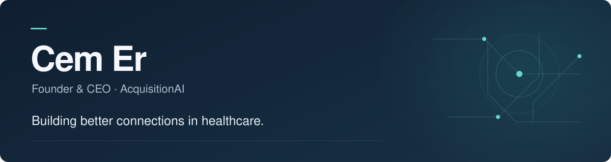

I'm Cem, founder and CEO of [AcquisitionAI](https://acquisitionai.com). I build AI voice agents and operational software for skilled nursing and post-acute care.

My focus is the work behind a conversation: helping someone reach the right team, keeping the context together, and making the next step clear.

### What I'm building

| Focus | The work |
| :--- | :--- |
| **Voice AI** | Call handling and routing built around each facility's teams and workflows. |
| **Connected operations** | Bringing conversations, requests, and follow-up into a shared workspace. |
| **Practical healthcare software** | Tools designed around staff review, facility context, and the realities of daily care. |

### How I work

Start with the workflow. Build something useful. Improve it with the people who use it.

Most of my product engineering lives in private repositories. You can explore the product and illustrative workflows on the [AcquisitionAI website](https://acquisitionai.com).

---

[AcquisitionAI](https://acquisitionai.com) &nbsp; · &nbsp; [LinkedIn](https://www.linkedin.com/in/cemerofficial/) &nbsp; · &nbsp; [X](https://x.com/CemEr949)
